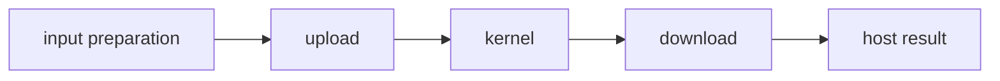

# Asynchronous Device Operations

A GPU workflow often includes transfers, kernels, and dependencies. The shared `cuda-async` runtime represents work as composable **device operations**, rather than requiring every stage to complete immediately.



An operation describes work and owns or borrows what it needs. Execution is triggered through the runtime's execution methods; merely building a lazy operation graph is not equivalent to completing it.

## Composition and scheduling

Dependent operations form a chain. Independent branches may be scheduled on different streams, subject to available resources and runtime rules. A final wait or await produces the host-visible result and exposes execution failures.

```text
chunk A: upload ─► compute ─► download
chunk B:     upload ─► compute ─► download
```

This is a conceptual overlap pattern, not a guarantee that the hardware overlaps all three stages.

## Ownership across completion

The runtime must keep input reads and output writes valid while device work is in flight. A CPU function returning does not establish GPU completion. Similarly, dropping a host future cannot be assumed to stop already submitted GPU instructions immediately.

Keep pipeline buffers independent between in-flight chunks and express reuse dependencies explicitly. Too many waits serialize the pipeline; missing waits can allow conflicting access.

Rust async executors and CUDA stream scheduling solve different problems. An executor polls futures on the CPU; streams order GPU work. Their integration should be understood rather than equated.

Related: [[Rust/Language/Advanced/async|Rust futures]] · [[Rust/GPU/foundations/streams|Streams and events]].

Sources: [DeviceOperation model](https://nvidia.github.io/cuda-rust/cuda-oxide/async-programming/the-device-operation-model.html), [overlapping transfers and compute](https://nvidia.github.io/cuda-rust/cuda-oxide/async-programming/overlapping-transfers-and-compute.html). Checked 2026-10-30; conceptual overview, no version-specific API calls.
