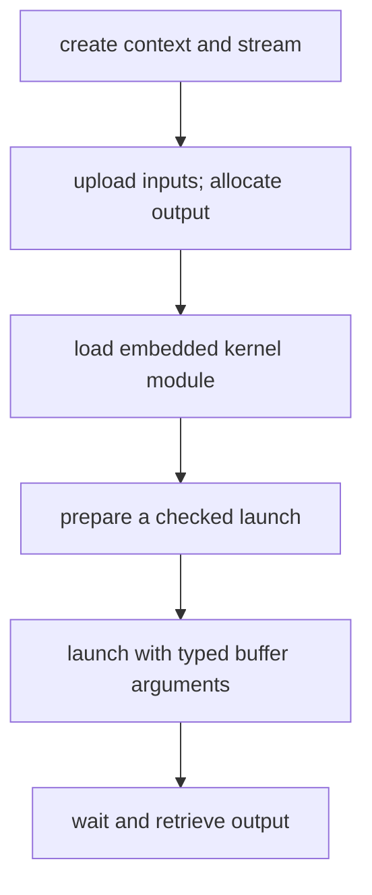

# cuda-oxide Buffers and Launches

A device kernel needs host-side preparation: a CUDA environment, device storage, compiled code, and a launch configuration.



The documented `#[cuda_module]` wrapper embeds device artifacts and generates typed load and launch methods. A launch contract enables a checked `PreparedLaunch` path. This preserves more information than passing a raw function pointer and arbitrary argument bytes.

**Host snippet — requires the annotated `kernels` module from the official example. Not a standalone program; not executed locally.**

```rust
let prepared = module.prepare_vecadd(
    LaunchConfig1D::new(1024_u32.div_ceil(256), 256, 0)
)?;
module.vecadd(&stream, &prepared, &a, &b, &mut c)?;
```

This launches four blocks of 256 threads. The final zero specifies no dynamically allocated shared-memory bytes. Generated method names follow the kernel name; `vecadd` is the official example's name.

Input `DeviceBuffer` values can be created from host data; the output can be allocated and initialized separately. The official wrapper's module-loading operation has an unsafe artifact-ownership contract. That requirement is distinct from using a checked launch.

Raw launch APIs remain available but shift geometry and argument obligations to the caller. A launch configuration must satisfy both hardware limits and the kernel's declared contract.

Related: [[Rust/GPU/cuda-oxide/first-kernel|Kernel body]] · [[Rust/GPU/foundations/streams|Stream ordering]].

Source: [Launching kernels](https://nvidia.github.io/cuda-rust/cuda-oxide/gpu-programming/launching-kernels.html). Checked 2026-10-30; live-book API, not release-pinned.
