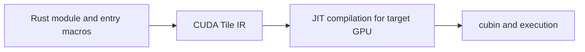

# cuTile Rust Notebook

cuTile Rust expresses GPU kernels as operations on tiles of tensor data. A normal high-level kernel loads a region, computes on the resulting tile values, and stores its output. The compiler maps these operations to GPU threads and instructions.

## Notes

- [[Rust/GPU/cutile-rs/setup|Environment and setup]]
- [[Rust/GPU/cutile-rs/tensors-tiles|Tensors, shapes, tiles, and partitions]]
- [[Rust/GPU/cutile-rs/vector-add|Vector addition and generated launchers]]
- [[Rust/GPU/cutile-rs/broadcasting-boundaries|Broadcasting and boundaries]]
- [[Rust/GPU/cutile-rs/reduction-matmul|Reduction and matrix multiplication]]
- [[Rust/GPU/cutile-rs/performance|Compilation, execution, and tuning]]

**Source snapshot:** checked 2026-10-30 against the official repository's `main` README and examples. The hosted `latest` book was not retrievable during authoring, so version-specific claims use the accessible repository sources. `main` is mutable; these notes are not a frozen release guide. GPU examples have not been compiled or executed locally.

The public release list includes cuTile Rust 0.4.0, but code here is not asserted to match that tag. Check the source checkout's manifest and release notes before copying APIs into a project.

Related: [[Rust/GPU/comparison|SIMT vs tile]] · [[Rust/GPU/glossary|Terminology]].

Sources: [Official cuTile README](https://github.com/NVIDIA/cuda-rust/blob/main/cutile-rs/README.md), [releases](https://github.com/NVIDIA/cuda-rust/releases), [cuTile book](https://nvidia.github.io/cuda-rust/cutile/latest/).
