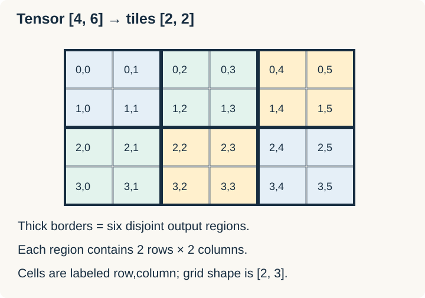

# Tensors, Shapes, Tiles, and Partitions

A **tensor** describes multidimensional data. Its **shape** gives axis lengths. A **tile** is a region used as a computation unit. A **partition** divides a view into such regions and determines which region each program instance processes.



```text
Tensor shape: [4, 6]
Tile shape:   [2, 2]
Tile grid:    [2, 3]
```

Shape and layout are different: shape says how many elements lie on each axis; strides describe their memory spacing. Reshaping a view does not automatically transpose or physically rearrange its elements.

## Views vs computed values

The kernel's tensor references describe regions in memory. Loading produces tile values for computation; storing writes results back. A loaded tile value should not be confused with an owned host `Vec` or an independently allocated device buffer.

Mutable output partitions must not overlap. Read-only inputs can be shared. This is how the high-level model relates Rust's exclusive mutable access to parallel work.

In the documented vector-add pattern, the output has a static tile extent `[B]` and input views use `[-1]` in the kernel signature. `load_like(output)` loads corresponding input regions. That `-1` is DSL shape notation, not ordinary Rust array-length syntax.

## Relation to SIMT

A tile does not mean “one thread.” The compiler distributes a tile operation over the hardware. Tile sizes affect generated code and performance, but high-level code need not specify every participating lane.

Related: [[Rust/GPU/cutile-rs/vector-add|Load, compute, store]] · [[Rust/GPU/cutile-rs/broadcasting-boundaries|Edges]].

Sources: [CUDA Rust tile model](https://nvidia.github.io/cuda-rust/), [official cuTile examples](https://github.com/NVIDIA/cuda-rust/tree/main/cutile-rs/cutile-examples/examples). Checked 2026-10-30; dimensions in the drawing are explanatory.
