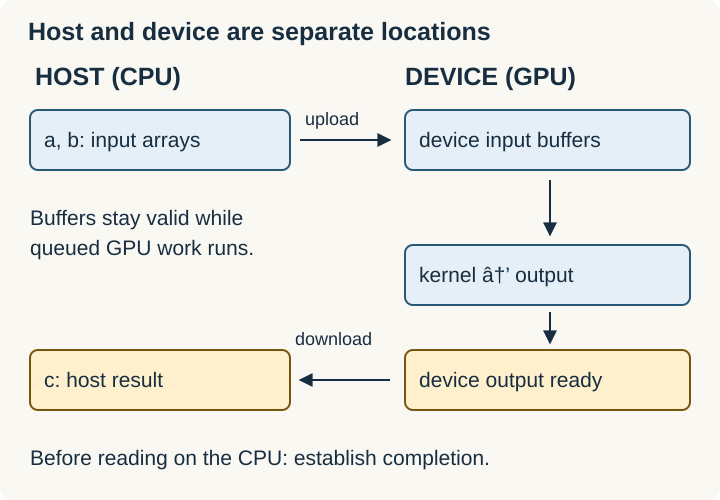
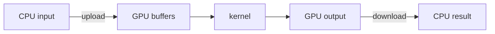

# Host, Device, Kernels, and Transfers

The **host** is the CPU side of the program. The **device** is the GPU. A **kernel** is a function executed on the GPU over many work items.

The host normally allocates device buffers, transfers inputs, launches kernels, and retrieves results. Device code operates on device-accessible data; a normal Rust reference to CPU memory is not automatically usable on the GPU.





## Example: vector addition

For `a = [1, 2, 3, 4]` and `b = [10, 20, 30, 40]`, the output is `[11, 22, 33, 44]`. The host prepares the arrays; the GPU computes independent additions.

**Conceptual pseudocode — not a crate API:**

```text
device_a = upload(a)
device_b = upload(b)
device_c = allocate(4 elements)
launch add(device_a, device_b, device_c)
wait until output is ready
c = download(device_c)
```

A launch often queues work rather than waiting for completion. Buffers and access permissions must remain valid until the queued operation finishes, not merely until the launch call returns.

## Runtime objects

A **context** manages a device execution environment. A **stream** orders submitted operations. A **module** contains compiled device code. A **device buffer** owns device memory. Exact ownership and construction APIs depend on the runtime.

Keeping intermediate data on the GPU avoids repeated transfers. Tiny operations can be slower on a GPU because launch and transfer overhead dominate the arithmetic.

Related: [[Rust/GPU/foundations/streams|Streams]] · [[Rust/GPU/cuda-oxide/buffers-launches|cuda-oxide buffers and launches]].

Sources: [CUDA programming model](https://docs.nvidia.com/cuda/cuda-programming-guide/01-introduction/programming-model.html), [CUDA Rust runtime](https://nvidia.github.io/cuda-rust/).
