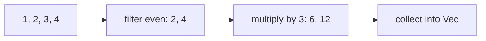

# Closures and Iterators

A **closure** is an anonymous function that can capture its environment. An **iterator** produces a sequence by repeatedly returning `Some(item)` or `None` from `next()`.

**Complete example:**

```rust
fn main() {
    let factor = 3;
    let values = [1, 2, 3, 4];
    let result: Vec<i32> = values.iter()
        .copied()
        .filter(|n| n % 2 == 0)
        .map(|n| n * factor)
        .collect();
    assert_eq!(result, vec![6, 12]);
}
```



This diagram shows logical transformations, not intermediate allocated vectors. Iterator adapters such as `map` and `filter` are lazy. Consumers such as `collect`, `sum`, and a `for` loop drive the computation.

## Captures

| Closure trait | What a call may do |
| --- | --- |
| `Fn` | Use captures through shared access |
| `FnMut` | Mutate captured state |
| `FnOnce` | Consume captured values |

All closures implement `FnOnce`; some also implement `FnMut` and `Fn`. `move` takes ownership of captures where appropriate, but does not by itself mean the closure can only be called once. Its body determines whether captures are consumed.

## Reusing Option

`filter_map` combines filtering and transformation: `["1", "bad", "2"].iter().filter_map(|s| s.parse::<i32>().ok())` yields 1 and 2. Here `.ok()` intentionally discards parse errors; use a Result-based collection when errors matter.

Related: [[Rust/Language/Modeling/option-result|Option vs Result]] · [[Rust/Language/Abstraction/collections|Collection iteration]].

Sources: [Closures](https://doc.rust-lang.org/book/ch13-01-closures.html), [iterators](https://doc.rust-lang.org/book/ch13-02-iterators.html).
