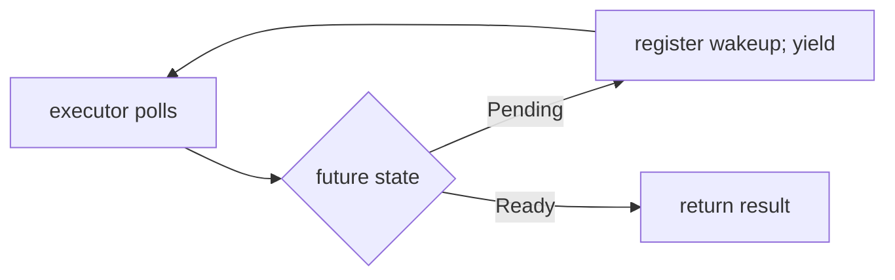

# Async, Await, and Futures

An `async fn` returns a **future**: a value representing an operation that can make progress when polled. Calling it does not spawn a thread or guarantee that its body runs immediately.

**Snippet — requires an executor to drive the future:**

```rust
async fn answer() -> u32 { 42 }

async fn report() {
    let value = answer().await;
    assert_eq!(value, 42);
}
```

`.await` lets the enclosing async task suspend if the awaited future is not ready. The executor can run other ready tasks during that suspension.



The standard library defines `Future`, but a general-purpose runtime is typically supplied by a library. Runtime APIs provide task spawning, asynchronous I/O, timers, and scheduling. The snippet above is language syntax, not a complete executable.

## Important distinctions

- **Async vs parallel:** Many async tasks can share one thread. CPU-heavy computation still consumes execution time and may need worker threads.
- **Sequential awaits vs concurrent work:** Awaiting one operation and then creating another is usually sequential. Concurrency requires arranging for both operations to make progress.
- **Blocking vs awaiting:** A blocking file operation or sleep can stall an executor thread. Async syntax does not convert blocking APIs into asynchronous ones.
- **Cancellation:** Dropping a future can cancel its remaining Rust-side work. Already submitted external work, including GPU work, may continue; its runtime must preserve resource validity.

`Pin` supports futures that must not be moved after polling; normal async use usually relies on runtime abstractions rather than manual polling.

Related: [[Rust/GPU/cuda-oxide/async|GPU operations and async]] · [[Rust/Language/Advanced/concurrency|Threads]].

Sources: [Async Book](https://rust-lang.github.io/async-book/), [Future](https://doc.rust-lang.org/std/future/trait.Future.html).
