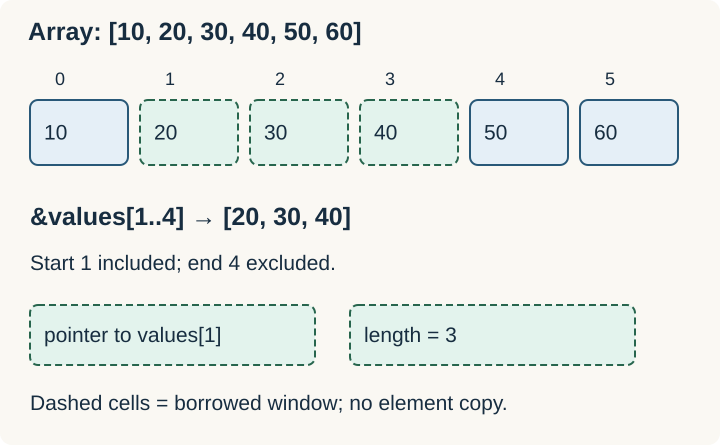

# Arrays, Tuples, Vec, and Slices

An **array** owns a fixed number of values of the same type. A **Vec** owns a growable sequence. A **slice** describes a contiguous sequence; it is normally used through a borrowed reference such as `&[T]`.



| Type | Length | Owns elements? | Typical use |
| --- | --- | --- | --- |
| `[T; N]` | `N` is part of the type | Yes | Fixed-size data |
| `Vec<T>` | Runtime, growable | Yes | Dynamic sequences |
| `&[T]` | Runtime, fixed view | No | Read a portion of a sequence |
| `&mut [T]` | Runtime, fixed view | No | Modify borrowed elements |

**Complete example:**

```rust
fn total(values: &[i32]) -> i32 {
    values.iter().sum()
}

fn main() {
    let values = [10, 20, 30, 40, 50, 60];
    let window = &values[1..4]; // [20, 30, 40]; end is exclusive
    assert_eq!(total(window), 90);

    let mut dynamic = vec![1, 2];
    dynamic.push(3);
    assert_eq!(total(&dynamic), 6); // Vec borrows as a slice
}
```

Creating a slice does not copy its elements. A slice reference carries a pointer and a length. Changing the range creates another view; it does not resize the underlying collection.

## Array syntax

`[0_u8; 16]` creates sixteen zero bytes. `[1, 2, 3]` has type `[i32; 3]` when inferred as `i32`. `[i32; 3]` and `[i32; 4]` are different types. `let mut a = [1, 2]; a[0] = 9;` changes an element without changing the length.

## Tuples

Tuples combine a fixed set of potentially different types: `let point: (i32, f64) = (3, 4.5);`. Access fields with `point.0`, or destructure with `let (x, y) = point;`. The empty tuple `()` is the unit type, commonly used when there is no meaningful return value.

Indexing and slicing panic when out of bounds. `values.get(99)` returns `None`; `values.get(1..4)` returns an optional slice.

Related: [[Rust/Language/Modeling/option|Option]] · [[Rust/Language/Abstraction/collections|Collections]].

Sources: [Compound types](https://doc.rust-lang.org/book/ch03-02-data-types.html#compound-types), [slice type](https://doc.rust-lang.org/book/ch04-03-slices.html), [Vec](https://doc.rust-lang.org/std/vec/struct.Vec.html).
