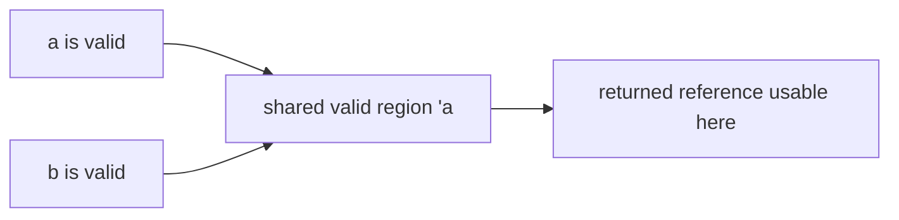

# Lifetimes

A lifetime describes where a reference is valid. Lifetime annotations express relationships between references; they do not keep a value alive or allocate memory.

**Complete example:**

```rust
fn longer<'a>(a: &'a str, b: &'a str) -> &'a str {
    if a.len() >= b.len() { a } else { b }
}

fn main() {
    let first = String::from("longer");
    let second = String::from("short");
    let selected = longer(&first, &second);
    assert_eq!(selected, "longer");
}
```

Both inputs and the output share `'a`. A call can use a lifetime that fits both inputs; the output cannot be used beyond that valid overlap. The annotation does not claim the original values were created together.



## Elision

Many annotations are inferred by lifetime-elision rules. `fn first(s: &str) -> &str` ties the result to the sole input reference. A method's borrowed output is commonly tied to `&self`. With multiple input references and no receiver, the compiler may need an explicit relationship.

A struct containing a borrowed reference must describe that dependency: `struct Label<'a> { text: &'a str }`. It cannot outlive the referenced text.

## `'static`

`&'static str` refers to text valid for the program's duration. A bound `T: 'static` means `T` contains no borrowed data with a shorter lifetime; it does **not** mean a value of `T` must live forever. An owned `String` can satisfy this bound and still be dropped normally.

Returning `&str` borrowed from a local `String` is invalid because that owner is dropped on return. Return an owned `String` instead.

Source: [Validating references with lifetimes](https://doc.rust-lang.org/book/ch10-03-lifetime-syntax.html).
