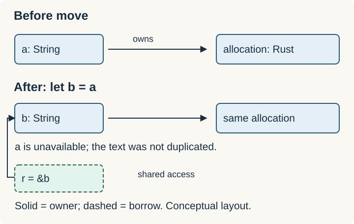

# Ownership and Borrowing

Ownership determines who is responsible for a value. A value has one owner at a time; when that owner is dropped, the value is dropped too. Shared-ownership containers such as `Rc` manage a value through several owning handles.

Assignment or passing an argument can **move** ownership. A **borrow** gives temporary access without transferring ownership.



**Complete example:**

```rust
fn length(text: &str) -> usize {
    text.len()
}

fn main() {
    let a = String::from("Rust");
    let mut b = a; // ownership moves; a is no longer usable
    let size = length(&b); // temporary shared borrow
    b.push('!'); // earlier shared borrow is no longer used
    assert_eq!((size, b.as_str()), (4, "Rust!"));
}
```

## The borrowing rule

For ordinary references to the same data, overlapping access permits **multiple shared references (`&T`) or one exclusive mutable reference (`&mut T`)**. References must remain valid for their uses.

| Access | What it permits |
| --- | --- |
| `&T` | Shared access; ordinary mutation is prohibited |
| `&mut T` | Exclusive access; permits mutation |
| Owned `T` | Responsibility for the value; can move or borrow it |

The compiler often ends a borrow at its last use, before the enclosing block ends. That is why `b.push` is allowed above. Interior mutability allows controlled mutation through shared references, with additional rules.

## Common error

Using `a` after `let b = a` is invalid for a `String`: its ownership moved. Borrow it when only access is needed; clone it only when an independent value is needed.

Ownership is independent of whether a value's bytes happen to be on the stack or heap.

Related: [[Rust/Language/Data/move-borrow-clone|Move vs borrow vs clone]] · [[Rust/Language/Data/lifetimes|Lifetimes]] · [[Rust/Language/Data/memory|Memory]].

Sources: [Ownership](https://doc.rust-lang.org/book/ch04-01-what-is-ownership.html), [references and borrowing](https://doc.rust-lang.org/book/ch04-02-references-and-borrowing.html).
