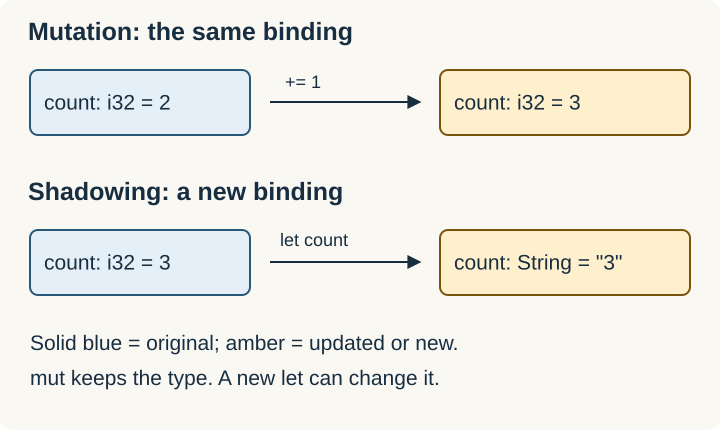

# Variables, Mutability, and Shadowing

`let` creates a binding between a name and a value. Bindings are immutable by default: assigning a different value to the same binding requires `mut`.

**Complete example:**

```rust
fn main() {
    let mut count = 2;
    count += 1;
    let count = count.to_string(); // new binding; a different type
    assert_eq!(count, "3");
}
```



| Syntax | Meaning |
| --- | --- |
| `let x = 3;` | Immutable binding |
| `let mut x = 3;` | Binding can be reassigned; its type stays fixed |
| `let x = x + 1;` | Shadowing: a new binding with the same name |
| `const LIMIT: usize = 32;` | Named constant with a compile-time value and explicit type |

Shadowing can change a name's type because it creates a new binding. `mut` cannot change the type of an existing binding. A shadowed value is not necessarily dropped at the shadowing statement; do not use shadowing as a resource-release mechanism.

## Mutable binding vs mutable reference

**Snippet:**

```rust
let mut value = 10;
let r = &mut value;
*r += 5; // changes value through an exclusive reference
```

`r` does not need a mutable binding to modify its referent. `let mut r` would allow reassigning `r` itself. `&mut T` describes access to the target; `mut` on a binding describes whether that binding can be changed.

Interior-mutability types are a separate mechanism: see [[Rust/Language/Advanced/interior-mutability|Interior mutability]].

Related: [[Rust/Language/Data/ownership|Ownership and borrowing]].

Source: [Rust Book: variables and mutability](https://doc.rust-lang.org/book/ch03-01-variables-and-mutability.html).
