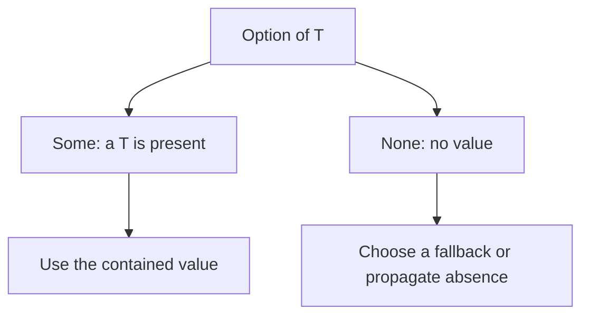

# Option — A Value May Be Absent

`Option<T>` makes absence explicit. It is an enum with two variants: `Some(T)` contains a value; `None` contains no value. A missing value is not automatically an error.



**Complete example:**

```rust
fn main() {
    let scores = [10, 20];
    let found: Option<&i32> = scores.get(1);
    let missing = scores.get(9);
    assert_eq!(found.copied(), Some(20));
    assert_eq!(missing.copied().unwrap_or(0), 0);
    assert_eq!(found.map(|n| n * 2), Some(40));
}
```

`get` returns a borrowed element because the array still owns the data. `.copied()` changes `Option<&i32>` into `Option<i32>` by copying the integer.

| Operation | Behavior |
| --- | --- |
| `match` / `if let` | Handle variants explicitly |
| `.map(f)` | Transform the present value |
| `.and_then(f)` | Chain a function returning another Option |
| `.unwrap_or(default)` | Supply a fallback |
| `.unwrap_or_else(f)` | Compute a fallback only when absent |
| `.ok_or(error)` | Convert absence into a Result error |
| `?` in an Option-returning function | Return `None` early if absent |

`unwrap()` panics on `None`. It is appropriate only when presence is an established invariant, not merely hoped for. `Option` itself does not imply heap allocation.

Related: [[Rust/Language/Modeling/option-result|Option vs Result]] · [[Rust/Language/Abstraction/collections|Lookups in collections]].

Sources: [Option](https://doc.rust-lang.org/std/option/enum.Option.html), [Option in the Rust Book](https://doc.rust-lang.org/book/ch06-01-defining-an-enum.html#the-option-enum-and-its-advantages-over-null-values).
