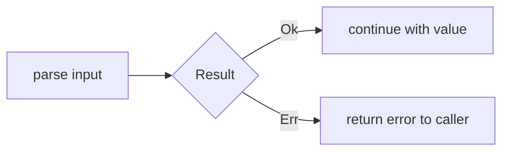

# Result, Error Propagation, and Panics

`Result<T, E>` represents success (`Ok(T)`) or failure (`Err(E)`). The error value explains what went wrong. It is the normal mechanism for recoverable failures such as invalid input or an unavailable file.

**Complete example:**

```rust
use std::num::ParseIntError;

fn doubled(text: &str) -> Result<i32, ParseIntError> {
    let n = text.parse::<i32>()?;
    Ok(n * 2)
}

fn main() {
    assert_eq!(doubled("21"), Ok(42));
    assert!(doubled("hello").is_err());
}
```

For `Result`, `?` extracts an `Ok` value or returns early on `Err`, converting the error through `From` where needed. It does not log or silently ignore the error.



`.map` transforms success, `.map_err` transforms failure, and `.and_then` chains another fallible operation. `match` lets the caller recover differently for different errors.

## Panic

A panic signals an unrecoverable condition in the current operation, often a violated programming invariant. Out-of-bounds indexing and failed `unwrap()` calls can panic. Depending on build configuration, panic unwinds the stack or aborts the process.

Use `Result` when the caller should be able to handle failure. Use `expect("reason")` only when failure contradicts an established invariant; its message should explain that invariant. A panic is not a substitute for normal input validation.

`main` can return `Result<(), E>` when `E` supports the required termination behavior, which makes `?` useful in command-line programs too.

Related: [[Rust/Language/Modeling/option-result|Option vs Result]].

Sources: [Recoverable errors](https://doc.rust-lang.org/book/ch09-02-recoverable-errors-with-result.html), [panic](https://doc.rust-lang.org/book/ch09-01-unrecoverable-errors-with-panic.html).
