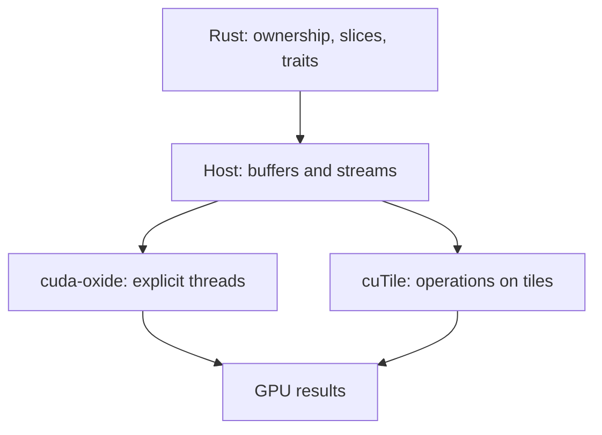

# Rust Visual Notebook

Short explanations of Rust and GPU programming, with code, diagrams, and comparisons. This is a reference notebook: open the concept you need, or use the categories below to explore.

## Language

[[Rust/Language/index|Browse all language notes]]

| Area | Start here |
| --- | --- |
| Foundations | [[Rust/Language/Foundations/cargo|Cargo and projects]] · [[Rust/Language/Foundations/mutability|Mutability and shadowing]] · [[Rust/Language/Foundations/types|Primitive types and conversions]] |
| Data and ownership | [[Rust/Language/Data/ownership|Ownership and borrowing]] · [[Rust/Language/Data/arrays-vec-slices|Arrays, Vec, and slices]] · [[Rust/Language/Data/strings|String and str]] |
| Modeling and errors | [[Rust/Language/Modeling/structs|Structs and methods]] · [[Rust/Language/Modeling/enums|Enums and matching]] · [[Rust/Language/Modeling/option|Option]] · [[Rust/Language/Modeling/result|Result and ?]] |
| Abstraction | [[Rust/Language/Abstraction/traits|Generics and traits]] · [[Rust/Language/Abstraction/iterators|Closures and iterators]] |
| Advanced | [[Rust/Language/Advanced/smart-pointers|Smart pointers]] · [[Rust/Language/Advanced/concurrency|Threads and synchronization]] · [[Rust/Language/Advanced/async|Async and futures]] · [[Rust/Language/Advanced/unsafe-ffi|Unsafe and FFI]] |

## Quick comparisons

- [[Rust/Language/Data/arrays-vec-slices|Array vs Vec vs slice]]
- [[Rust/Language/Data/strings|String vs &str]]
- [[Rust/Language/Data/move-borrow-clone|Move vs borrow vs clone]]
- [[Rust/Language/Modeling/option-result|Option vs Result]]

## GPU programming

[[Rust/GPU/index|GPU notebook]] — shared concepts, cuda-oxide (SIMT), and cuTile (tile programming).

## About the examples

Language notes target stable Rust with edition 2024. Blocks labeled **Complete example** include an entry point; blocks labeled **Snippet** belong inside surrounding code. GPU syntax is tied to the dated sources on each page. Conceptual pseudocode is labeled explicitly.

See [[Rust/sources|Sources and verification]] for source provenance and local validation limits.
